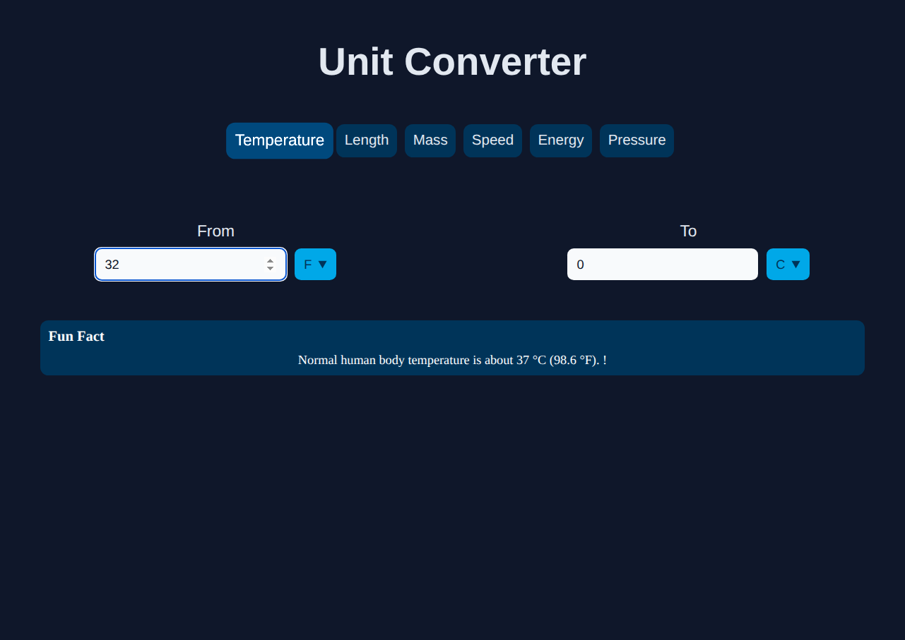

## Unit Converter

This is a basic website to convert between scientific units in 6 of the most essential categories, with a random fun fact that appears when you change category.



Categories supported and their units:

| Category    | Units                               |
| ----------- | ----------------------------------- |
| Temperature | C, K, F                             |
| Length      | mm, cm, m, km, in, ft, yd, mi       |
| Mass        | mg, g, kg, t, oz, lb                |
| Speed       | m/s, km/h, mph, kn, ft/s            |
| Energy      | J, kJ, cal, kcal, Wh, kWh, BTU      |
| Pressure    | Pa, kPa, bar, atm, psi, mmHg        |


### What stack was used
HTML, CSS, and vanilla JavaScript

### How to run it locally
- Clone the repo or download the ZIP folder directly from GitHub:

  ```bash
  git clone https://github.com/AmrGamalbit/unit-converter
  ```

- Open the project folder on your device.
- Double-click on `index.html`.